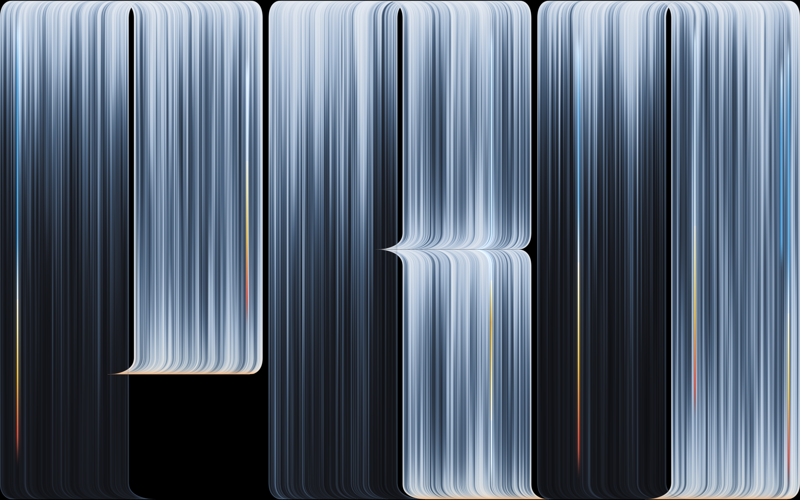
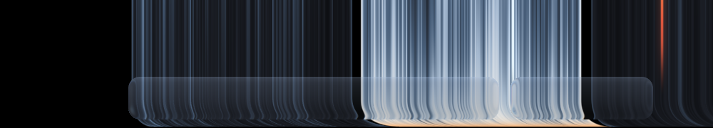

# Glass Desktop

A macOS-style dock for the Windows 11 taskbar, sitting on an animated
[PRO Threads](https://github.com/kubai087/pro-threads) wallpaper that bends and
refracts behind it like real glass.





## What you get

- **Dock taskbar.** The taskbar becomes a centered, rounded pill with the system
  tray in a second pill beside it. Icons are 32 px on a 54 px bar and magnify
  under the cursor (up to 115%, no bounce). Built from three Windhawk mods and
  the settings in [`windhawk/`](windhawk).
- **Liquid Glass.** Windows can't refract what's behind a window, but the only
  thing ever behind the taskbar is the wallpaper. So the taskbar is made fully
  transparent and the wallpaper draws the glass itself: a curved rim that bends
  the threads behind it, a little color dispersion, a soft top light.
- **DockGlass**, a small helper that tells the wallpaper where the dock and tray
  are. Source only, about 300 lines of C#; it builds with the compiler that
  ships with Windows.

## Requirements

- Windows 11 (tested on 25H2)
- [Windhawk](https://windhawk.net)
- [Lively Wallpaper](https://apps.microsoft.com/detail/9ntm2qc6qws7) from the
  Microsoft Store (tested with 2.5.6). DockGlass expects the Store version's folders.
- Nothing else to build DockGlass: it uses .NET Framework 4.8, which is part of Windows.
- Node.js only if you want to change and rebuild the wallpaper.

## Install

### 1. Taskbar (Windhawk)

Install these mods from Windhawk's **Explore** tab. For each one, open the mod,
go to **Advanced**, replace everything under **Mod settings** with the file's
contents, and click **Save**.

| Order | Mod (Windhawk ID) | Settings file | Tested version |
| --- | --- | --- | --- |
| 1 | Windows 11 Taskbar Styler (`windows-11-taskbar-styler`) | [`windows-11-taskbar-styler.yaml`](windhawk/windows-11-taskbar-styler.yaml) | 1.11 |
| 2 | Taskbar height and icon size (`taskbar-icon-size`) | [`taskbar-icon-size.yaml`](windhawk/taskbar-icon-size.yaml) | 1.3.11 |
| 3 | Taskbar Dock Animation (`taskbar-dock-animation`) | [`taskbar-dock-animation.yaml`](windhawk/taskbar-dock-animation.yaml) | 1.9.2 |

The Styler theme uses `{{ }}` variables, which need Taskbar Styler 1.11 or newer.
Until the wallpaper and DockGlass are set up, the taskbar is see-through with no
glass behind it. That's expected.

### 2. Wallpaper and DockGlass (script)

```powershell
git clone https://github.com/<you>/glass-desktop
cd glass-desktop
powershell -ExecutionPolicy Bypass -File scripts\install.ps1
```

The script:

1. builds `DockGlass.exe` into `%LOCALAPPDATA%\GlassDesktop`,
2. copies `wallpaper\pro-threads-glass` into Lively's library as `prothreads.live`,
3. adds a `DockGlass` shortcut to your Startup folder and starts it.

Then restart Lively (tray icon > **Exit**, open it again) and pick
**PRO Threads Glass** in its library.

In Lively's **Settings > Performance**, set the rules for other apps being
focused and fullscreen to **Keep running**. DockGlass pauses the animation
itself when a window covers the desktop, and the glass behind the taskbar has
to keep updating.

Flags: `-NoWallpaper`, `-NoStartup`, `-InstallDir <path>`, `-LivelyLibrary <path>`, `-Uninstall`.

### Or by hand

1. Copy the `wallpaper\pro-threads-glass` folder to
   `%LOCALAPPDATA%\Packages\12030rocksdanister.LivelyWallpaper_97hta09mmv6hy\LocalCache\Local\Lively Wallpaper\Library\wallpapers\prothreads.live`
   and restart Lively.
2. Run `dockglass\build.cmd`. It writes `dockglass\DockGlass.exe`.
3. Run `DockGlass.exe`. To start it at sign-in, put a shortcut to it in
   `shell:startup`.

If the wallpaper lives somewhere else (say you imported it through Lively's
**+** button, which picks a random folder name), pass its `geometry.js` path:
`DockGlass.exe "C:\path\to\wallpaper\folder\geometry.js"`.

## How DockGlass works

DockGlass reads the taskbar's layout through UI Automation and writes it to
`geometry.js` in the wallpaper's folder, only when something changed. The
wallpaper loads that file four times a second and draws the glass pills into
its own frame. The file holds the screen size, the display scale, the dock and
tray rectangles, and a mode:

| Mode | When | Wallpaper |
| --- | --- | --- |
| `visible` | the desktop shows | animates, glass on top |
| `covered` | a maximized window hides the desktop | stops animating; redraws only when the dock changes size |
| `hidden` | a fullscreen app hides the taskbar | draws nothing |

The layout is read when an app window opens or closes (the dock changes width)
and every 3 seconds as a fallback; the cheap window check behind the mode runs
every 250 ms.

It also watches Lively's log. When the wallpaper's browser crashes (it happens
when the GPU resets on waking from sleep), Lively leaves a sad-face page; DockGlass
sees `CoreWebView2 process failed` and sets the wallpaper again through Lively's
own command line, at most once every 30 seconds.

It makes no network connections, writes nothing but `geometry.js`, and only one
copy runs at a time. Primary monitor only.

## Tweaking

- **Magnification**: `MaxScale` (percent) and `EffectRadius` (px) in
  `taskbar-dock-animation.yaml`.
- **Taskbar size**: `TaskbarHeight` and `IconSize` in `taskbar-icon-size.yaml`.
  The glass follows, because DockGlass reads the real layout.
- **Glass look**: `GLASS_LOOK` at the top of `wallpaper/src/glass.js` (rim width,
  thickness, tint, brightness). Rebuild the wallpaper with:

  ```
  node wallpaper/src/build-glass.mjs wallpaper/src/pro-threads.base.html wallpaper/src/glass.js wallpaper/pro-threads-glass/index.html
  ```

  then run the install script again or copy `index.html` over.

## Undo

1. In Windhawk, disable or remove the three mods. The taskbar goes back to normal.
2. Run `scripts\install.ps1 -Uninstall`. It stops DockGlass, removes the startup
   shortcut and deletes `%LOCALAPPDATA%\GlassDesktop`. If you set it up by hand,
   end `DockGlass.exe` in Task Manager and delete its shortcut from `shell:startup`.
3. In Lively, pick another wallpaper or delete **PRO Threads Glass** from the
   library. Closing Lively brings back your normal Windows wallpaper.

## Troubleshooting

**The taskbar is transparent but there's no glass.** DockGlass isn't running or
writes somewhere else. Check Task Manager for `DockGlass.exe`, and that the
wallpaper folder is `prothreads.live` or that you passed its `geometry.js` path.

**The glass doesn't line up with the icons.** DockGlass's offsets match the
included Styler theme. If you changed the theme's margins or padding, adjust
`Layout()` in `dockglass/DockGlass.cs` and rebuild.

**A second DockGlass does nothing.** Only one copy runs; the new one exits
straight away. End the old one first.

**The taskbar looks stock again after a Windows update.** Taskbar internals
change between builds. Update the mods in Windhawk; if the Styler theme still
breaks, open an issue with your Windows build number.

**The wallpaper freezes when you switch apps.** Lively is pausing it. Set its
focus and fullscreen rules to **Keep running** (see above).

**`csc.exe` not found.** The script expects
`%WINDIR%\Microsoft.NET\Framework64\v4.0.30319\csc.exe`, which every Windows 11
install has unless .NET Framework 4.8 was removed.

## Credits

- [PRO Threads](https://github.com/kubai087/pro-threads) by kubai087 (MIT): the
  wallpaper itself. This repo adds only the glass layer.
- [Windhawk](https://windhawk.net) by m417z. Mods: Windows 11 Taskbar Styler and
  Taskbar height and icon size by m417z, Taskbar Dock Animation by Ph0en1x-dev.
- [Lively Wallpaper](https://github.com/rocksdanister/lively) by rocksdanister.

Apple, macOS and MacBook Pro are trademarks of Apple Inc. This project isn't
affiliated with Apple and contains no Apple artwork.

## License

MIT, see [LICENSE](LICENSE). PRO Threads is MIT, copyright Kubai087; see
[THIRD_PARTY_NOTICES.md](THIRD_PARTY_NOTICES.md).
